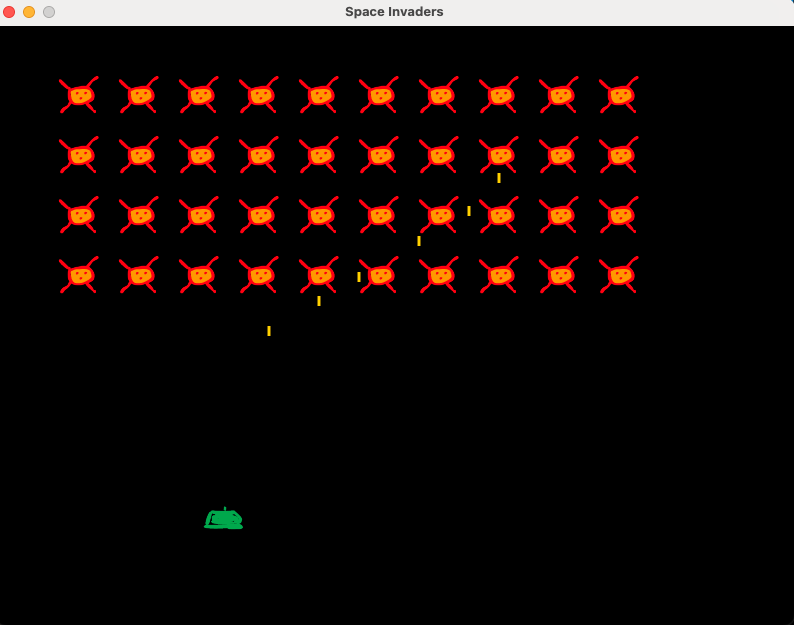
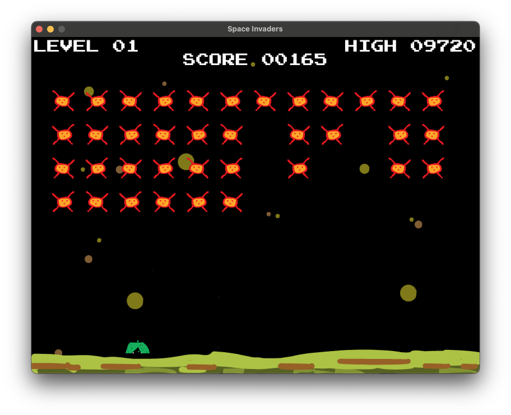
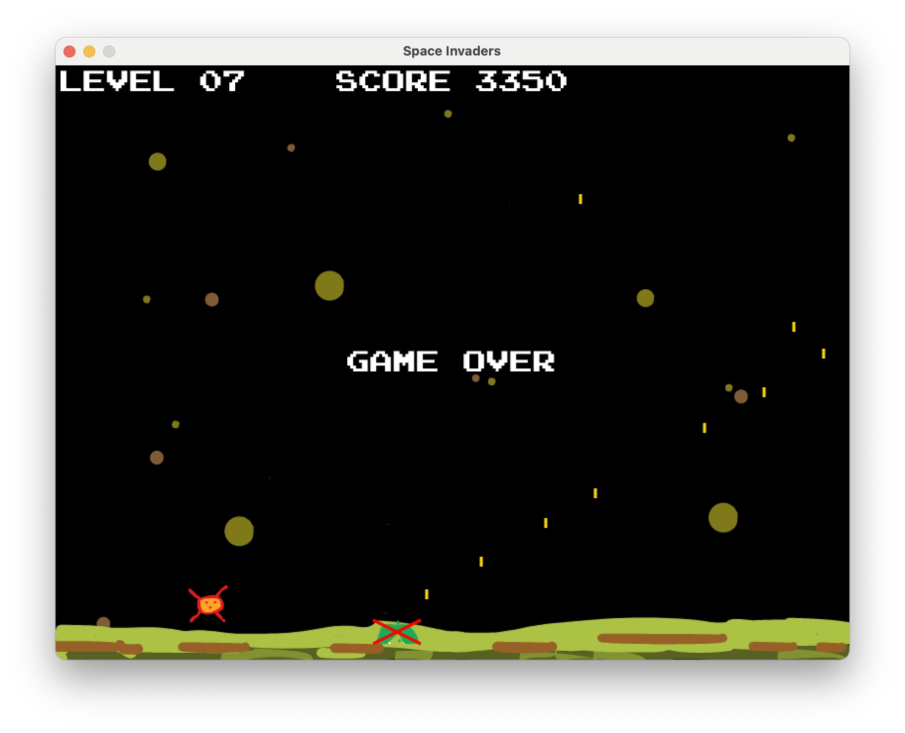

# Space Invaders

Single-player arcade Space Invaders in Go using Donburi ECS and Ebitengine.

## Build and test

Use Go 1.27.2, matching go.mod:

```sh
go mod download
go test ./...
go vet ./...
go build ./...
go run .
```

Use `go run . -level 3` to start at another level (minimum 1). Linux needs the
graphics/audio libraries and display described in CI; headless checks use Xvfb.

## Browser

Run `go run ./cmd/web -serve` and open http://localhost:8080. The game loads
automatically. Click inside for input/audio; high scores persist in this browser
with a session fallback when storage is blocked. Cloudflare publishing is deferred
until the owner provisions the project; CI only builds downloadable artifacts.

## Controls

- Left/Right arrows: move.
- Space: fire one shot per press.
- P: pause/resume. R: restart at the starting level.
- Q: save and quit (native only).

Native high scores use `score/highscore.txt` relative to the working directory.
Browser and native scores are independent.

## Documentation

- [Project specification](docs/PROJECT_SPEC.md) — current gameplay and architecture.
- [Coding standards](docs/CODING_STANDARDS.md).
- [Tests and coverage](docs/TESTING.md).
- [Browser build and limitations](docs/BROWSER.md).
- [Deferred deployment checklist](docs/DEPLOYMENT.md).
- [Shared website footer pattern](docs/WEB_DESIGN.md).

Graphics/sounds are embedded from assets/. Their provenance and licensing are not
documented in this repository; no additional ownership/license claims are made.

## TODO
* Different aliens
* ~~Aliens shoot~~
* ~~Vertical orientation~~
* ~~Destructible Barriers~~
* ~~Pause game~~
* ~~Stretch: Webassembly for Browser~~
* ~~use https://github.com/yohamta/donburi/ to create a game~~
* ~~Fire bullets~~
* ~~Define board size, borders, kill zone~~
* ~~collision detection~~
  * ~~Destroy aliens~~
  * ~~Kill player~~
* ~~Swarm of aliens~~
* ~~Track scores~~
  * ~~Write high scores to a file~~
* ~~Cool background~~
* ~~Levels with speed ups~~
* ~~Reset game~~
* ~~Audio for shots and explosions~~

## Images
### Player

### Alien


### Gameplay
Early development 


Recent development


### Game Over


## Gameplay Video
[Gameplay on Youtube](https://youtu.be/7HiF58Qha1s)